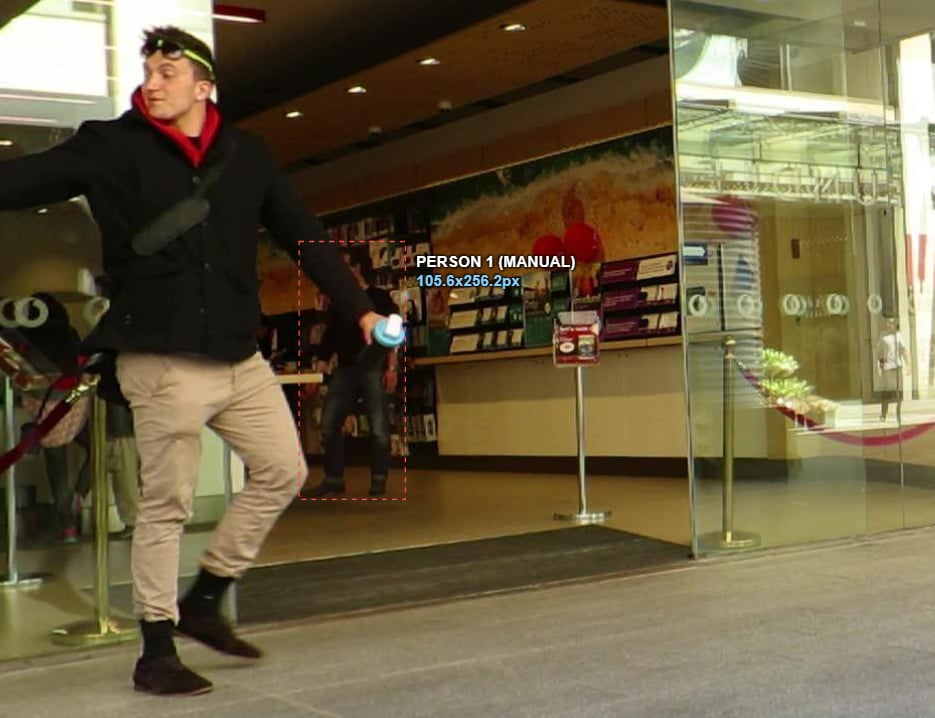
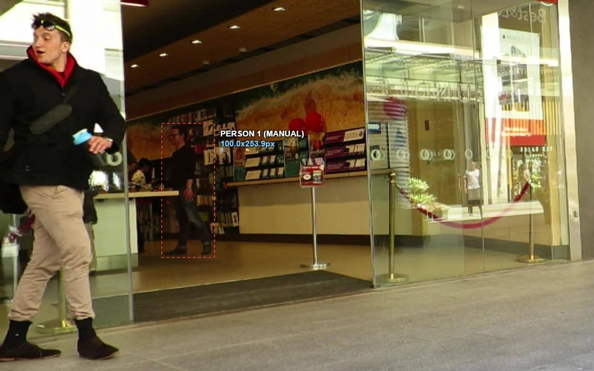

# Báo cáo cá nhân — Đỗ Quang Tùng-2A202603108

Đổi tên file theo quy tắc `MSSV_HoTen.md`. Ví dụ: `20241234_NguyenVanAn.md`.

Đoạn video: MOT17-09, 150 frame (frame 1–150), nguồn MOTChallenge, giấy phép CC BY-NC-SA 3.0.

## 0. Thông tin học viên

- Họ tên: Đỗ Quang Tùng
- MSSV: 2A202603108
- Mã đề (A/B/C): B
- Email: 26ai.tungdq@vinuni.edu.vn
- Link repository: https://github.com/dqtung1703/K5-L2-DAY05-DoQuangTung-03108-MOTTracking.git
- Giờ bắt đầu: 16:30
- Giờ kết thúc: 18:32

## 1. Xem trước đoạn video (CP0)

Ghi **trước khi vẽ**, mỗi người một dòng.

| Mã | Frame xuất hiện | Frame cuối thấy được | Rẽ / dừng / đổi tốc độ ở frame | Bị che ở frame | Ghi chú |
|---|---|---|---|---|---|
| P1 |0 |149 |6–15 (đổi hướng/tốc độ), 90–111 (đứng lại/chậm dần), 112–149 (di chuyển tiếp) |0–37, 45–54, 99–111 (che một phần); 38–44 (mất hẳn) |Bị che nhiều lần; khuất hẳn 7 frame rồi hiện lại đúng quỹ đạo |
| P2 |0 |149 |10–20, 60–63, 90–92, 120–124, 130–133 (đổi góc/tốc độ tiến lại gần) |Không |Di chuyển từ xa lại gần camera, kích thước box tăng liên tục |
| P3 |0 |145 |0–50 (di chuyển chậm), 50–105 (gần như đứng yên) |106–109, 137–145 (che một phần); 110–136 (mất hẳn) |Bị P2/P5 đi ngang qua che khuất hoàn toàn từ frame 110 đến 136 |
| P4 |1 |101 |1–51 (di chuyển chậm), 51–101 (đứng yên tại chỗ) |89–101 (che một phần); từ 102 trở đi (mất hẳn) |Đứng yên ở hậu cảnh từ frame 51, sau đó bị người đi trước che khuất hẳn |
| P5 |39 |149 |39–69 (vừa vào khung hình), 119–123, 129–139 (tăng tốc tiến lại gần) |Không |Xuất hiện từ mép phải (frame 39), đi chéo lại gần camera |

## 2. Keyframe và thời gian (CP1, CP4)

Số keyframe lấy từ kết quả `src/check_submission.py`.

| Mã | Số keyframe | Keyframe ở frame | Số frame có mặt | Keyframe / 100 frame | Thời gian (phút) | Chỗ khó |
|---|---|---|---|---|---|---|
| P1 | 68 | 0, 6, 8–12, 14–16, 18–21, 24–30, 45, 47–50, 54–60, 62–64, 66, 68–70, 72, 74, 76, 80, 88–90, 99–105, 107, 110–115, 120, 130, 140, 142–144, 149 | 143 | 47,6 |42 |Bị che khuất nhiều đợt (mất hẳn frame 38–44), đổi hướng và thay đổi dáng liên tục |
| P2 |25 |0–4, 6–7, 9–10, 20, 26–28, 30, 40, 50, 60–63, 70, 80, 83, 89–92, 100, 110, 120–121, 124, 130, 133, 140, 149 |150 |16,7 |18 |Tiến lại gần camera nên kích thước box phóng to nhanh và lệch tỷ lệ |
| P3 |9 |0, 10, 20, 30, 40, 50, 60, 100, 106, 110, 137, 140, 146 |119 |7,6 |9 |Ở xa (box nhỏ) và bị che khuất hoàn toàn 27 frame (frame 110–136) |
| P4 |11 |1, 11, 21, 31, 41, 51, 89, 102, 111, 121, 131, 139, 149 |101 |10,9 |10 |Bị che khuất từ frame 89 và biến mất hẳn ở hậu cảnh từ frame 102 |
| P5 |22 |39, 49, 59, 69, 79, 89, 99, 109, 119, 123, 129, 139, 149 |111 |19,8 |16 |Mới đi vào từ mép phải khung hình (bị cắt một phần cạnh phải ở các frame đầu) |
| **Tổng** | 135 | | 624 | 21,6 |95 |(Cộng ~27 phút cài đặt, xem trước & xuất/kiểm tra file = 122 phút) |

Keyframe / 100 frame của cả bài = tổng keyframe ÷ tổng số frame có mặt × 100 = 135 ÷ 624 × 100 ≈ 21,6

Bạn đặt keyframe nhiều nhất ở người nào? Vì sao (người đó rẽ, dừng, lại gần camera hay bị che)?

Em đặt keyframe nhiều nhất ở người P1. Nguyên nhân là do P1 vừa di chuyển theo quỹ đạo phi tuyến, vừa bị che khuất nhiều lần bởi các vật thể/người khác buộc phải đặt keyframe dày để bật/tắt cờ occluded, outside và giữ bounding box không bị trượt khỏi người.

## 3. Đoạn bị che (CP2)

Người bị che: `P1`

| Mốc | Frame |
|---|---:|
| Bắt đầu bị che một phần (bật `occluded`) | |
| Mất hẳn (bật `outside`) | 38 |
| Hiện lại (tắt `outside`) | 45 |
| Thấy rõ trở lại (tắt `occluded`) | |

- Thời gian khuất hẳn: 7 frame = 0,23 giây (frame CVAT 38–44).
- Quyết định: giữ cùng ID (P1 chỉ có một track suốt đoạn).
- Lý do (trả lời 3 câu: khuất bao lâu so với 60 frame, ngoại hình có khớp, chỗ hiện lại có đúng hướng và tốc độ): khuất 7 frame, ngoại hình có khớp, chỗ hiện lại đúng hướng.

Ảnh chụp màn hình:





## 4. Tự review ID (CP3)

Lượt 1 theo người (đi ngược từ frame 149 về 0 trên CVAT), lượt 2 theo cảnh (nhảy 10 frame). Ít nhất 3 dòng; không có lỗi thì ghi một dòng "đã kiểm hai lượt, không lỗi".

Loại lỗi dùng đúng một trong 7 mã: `id_switch`, `fragmentation`, `lost`, `merge`, `false_track`, `drift`, `flag`.

| Frame | Mã người | Loại lỗi | Mô tả một câu | Phát hiện ở lượt | Đã sửa? |
|---:|---|---|---|---|---|
| | | | | | |
| | | | | | |
| | | | | | |

Tổng hợp số lỗi theo loại:

| `id_switch` | `fragmentation` | `lost` | `merge` | `false_track` | `drift` | `flag` |
|---:|---:|---:|---:|---:|---:|---:|
| | | | | | | |

Lỗi nào chỉ lượt 2 (theo cảnh) mới thấy, lượt 1 (theo người) không thấy? Vì sao?

...
Đã kiểm hai lượt, không lỗi.
## 5. File xuất và kết quả tự kiểm (CP4)

| Kiểm tra | Kết quả |
|---|---|
| Tên file MOT 1.1 | `DoQuangTung_mot.zip` |
| Tên file CVAT for video 1.1 | `DoQuangTung_cvat_video.zip` |
| Số track ID khác nhau trong `gt/gt.txt` (phải là 5) | 5 |
| Frame `outside` không có dòng trong `gt.txt` (đúng / sai) | Đúng (P1 vắng ở frame CVAT 38–44 theo script) |
| Job đã completed trên CVAT máy cá nhân | |

Dán phần tóm tắt in ra từ `src/check_submission.py`:

```text
=== File MOT 1.1: DoQuangTung_mot.zip ===
  Số track ID: 5   |   Tổng số box: 624
  [OK]        Đúng 5 track ID.

  Track | Frame có mặt | Số frame | Đoạn vắng (outside)
      1 |   0–149      |      143 | 38–44
      2 |   0–149      |      150 | -
      3 |   0–145      |      119 | 110–136
      4 |   1–101      |      101 | -
      5 |  39–149      |      111 | -

=== File CVAT for video 1.1: DoQuangTung_cvat_video.zip ===
  Track | Nhãn   | Frame thấy | Keyframe | KF/100 frame | Frame occluded | Lần bật outside
      0 | person |        143 |       68 |         47.6 |             61 |               1
      1 | person |        150 |       36 |         24.0 |              0 |               0
      2 | person |        111 |       13 |         11.7 |              0 |               0
      3 | person |        119 |       11 |          9.2 |             13 |               2
      4 | person |        101 |        7 |          6.9 |             13 |               1

  Tổng: 135 keyframe / 624 frame có mặt = 21.6 keyframe / 100 frame
  [OK]        Đọc được 5 track từ annotations.xml.

=== Tóm tắt ===
  Lỗi: 0   |   Cảnh báo: 0
  Đạt. Dán phần tóm tắt này vào báo cáo mục 5.
```

## 6. Ba câu kết

1. Nếu được gán lại, bạn sẽ đặt keyframe khác ở đâu? Vì sao?

   Nếu được gán lại, Em sẽ tập trung đặt keyframe ngay trước và sau khi bị che khuất, khi vật thể thay đổi tư thế.

2. Có chỗ nào bạn không chắc "cùng ID hay ID mới"? Bạn đã quyết định và ghi chú thế nào?
   Nếu người xuất hiện lại ở đúng vị trí dự đoán và đúng thời điểm ước tính thì sẽ giữ nguyên ID cũ.
   Nếu người biến mất hoàn toàn ra khỏi khung ảnh một thời gian dài thì sẽ cấp ID mới.

3. Một lỗi ID trong job của bạn (nếu không còn sót, chọn lỗi đã sửa) có thể làm xe tự lái dự đoán sai chuyển động của người đó như thế nào? Lỗi đó ảnh hưởng MOTA hay IDF1 nhiều hơn?

   Nếu bị đứt thành ID mới (sau khi khuất): Xe tự lái mất toàn bộ lịch sử quỹ đạo cũ, lầm tưởng người này mới xuất hiện và đang đứng yên, làm chậm phản xạ phanh dù thực tế họ đang chạy băng qua đường.
   
   Nếu bị tráo ID với người khác: Vector vận tốc bị đảo ngược sang hướng của người kia, khiến xe dự đoán sai hoàn toàn hướng di chuyển (ví dụ tưởng người đó đi vào vỉa hè trong khi họ đang lao ra lòng đường).

   Ảnh hưởng đến IDF1 nhiều hơn.
   Vì MOTA chủ yếu đo chất lượng phát hiện từng frame.

## Bonus (nếu làm)

### B1 — Hai người đi sát

...

### B2 — So cách đặt keyframe

| Cách đặt | Số keyframe | Frame trôi nhất | Ghi chú |
|---|---:|---:|---|
| Đều mỗi 30 frame | | | |
| Theo chỗ đổi hướng | | | |

...

### B3 — So với tracker có sẵn

| Frame | Mã người | Tracker làm gì | Nhãn của bạn | Giải thích (đoán rồi sửa / ghép IoU / box score thấp / ngoại hình) |
|---:|---|---|---|---|
| | | | | |
| | | | | |

## 7. Tài liệu tham khảo và công cụ AI đã dùng

...
